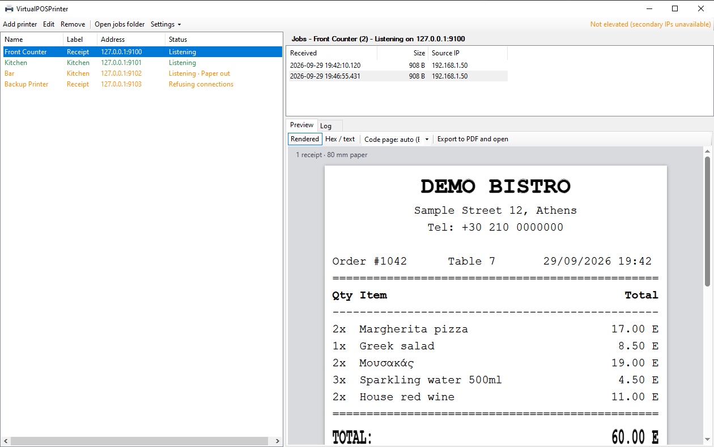
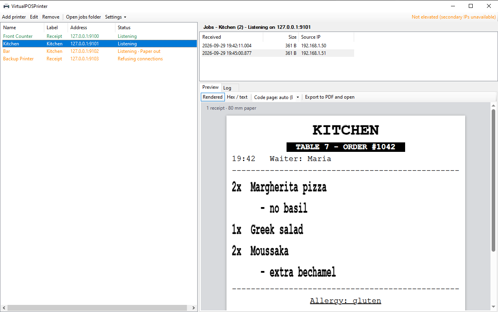
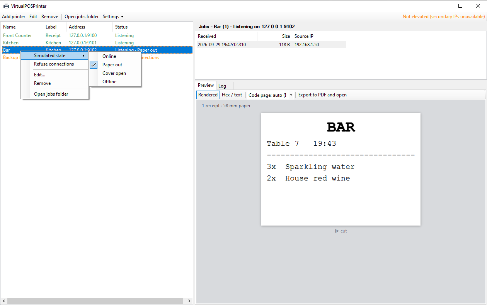

# VirtualPOSPrinter

**Virtual ESC/POS network printers for testing POS and order-management systems.**

VirtualPOSPrinter is a Windows desktop app that pretends to be one or more network receipt printers. It listens on
raw TCP (the "port 9100" protocol), captures whatever your software prints, and shows it as a realistic receipt
preview, so you can develop and test receipt and kitchen-ticket printing without a single sheet of paper.




## Features

- **Many printers at once**: each with its own name, label (Receipt / Kitchen), IP, port, paper width (80 mm or 58 mm)
  and an async listener that never blocks the UI.
- **Real network addresses**: bind to an existing local IP, or let the app add a *secondary IP* to a network adapter
  (`netsh`, needs admin) so every printer can have its own address on port 9100. The IP is removed again on delete or exit.
- **Faithful ESC/POS preview** rendered as HTML in WebView2 at printer scale (80 mm = 576 dots, 12x24 character cell):
  text styles, alignment, double size, inverted text, images, QR codes, barcodes, and one paper strip per cut.
- **Greek and other code pages done right**: CP737, CP869, CP1253, ISO-8859-7, CP852, CP858, CP437 and more, with a
  one-click override when a printer's `ESC t` numbering differs from the usual.
- **Behaves like a real printer**: answers status queries (`DLE EOT`, `GS r`, ...) so the POS sees it as online.
- **Failure simulation**: online, paper out, cover open, offline, connection delay, refused connections.
- **Job history**: every job is stored as a raw `.bin`; replay, delete, export to PDF, or inspect the hex dump.
- **Tray icon**, start minimized, optional start with Windows.
- No paid or heavy dependencies: the only NuGet package is WebView2. QR, barcode and PNG encoders are built in.

| Kitchen ticket | Simulated states |
|---|---|
|  |  |

## Quick start

Requirements: Windows 10/11, the [.NET 8 SDK](https://dotnet.microsoft.com/download/dotnet/8.0) (a newer SDK works too)
and the Evergreen [WebView2 Runtime](https://developer.microsoft.com/microsoft-edge/webview2/), which ships with current
Windows and Edge. Without WebView2 the app still works and falls back to the hex view.

```powershell
git clone https://github.com/Jorfan/VirtualPOSPrinter.git
cd VirtualPOSPrinter
dotnet run --project src/VirtualPOSPrinter
```

Add a printer (**Add printer**), point your POS at the shown `IP:port`, and print. Try it without a POS:

```powershell
# PowerShell: send a receipt to the printer on 127.0.0.1:9100
$c = New-Object Net.Sockets.TcpClient('127.0.0.1', 9100)
$b = [Text.Encoding]::ASCII.GetBytes("Hello from PowerShell`n`n`n") + [byte[]](0x1D,0x56,0x00)   # text + cut
$c.GetStream().Write($b, 0, $b.Length); $c.Close()
```

Run it **as administrator** if you want secondary-IP printers; everything else works without elevation.

## How it works

A print job is everything a client sends on one TCP connection until it closes it. The app saves the bytes, parses the
ESC/POS stream into a small document model (one receipt per cut), and renders that as HTML. Multiple printers can share
one IP if they use different ports, or each get their own IP with the secondary-IP mode. Your POS system simply
uses `IP:port` like it would for a real printer; if it runs in the cloud, it needs a local print agent or a tunnel
to reach a LAN address, and you may need to allow the port through Windows Firewall.

### Using it

- **Preview**: select a job (or let *auto-open* pick new ones). Toggle **Rendered / Hex / text**, force a **code page**,
  or **Export to PDF and open** (page width = paper width).
- **Simulation**: right-click a printer for *Simulated state* and *Refuse connections*; **Edit** has the connection delay.
- **Jobs**: right-click for *Replay...* (sends the saved bytes to any host and port, so you can print the same job on
  a real printer), *Delete* and *Clear all jobs*.
- **Settings menu**: start minimized to tray, close button hides to tray, start with Windows (secondary-IP printers still
  need a manual elevated start, because Windows cannot auto-start an elevated app).
- **Data** is stored next to the executable: `printers.json`, `settings.json`, `jobs/<printer>/<timestamp>.bin`
  (+ `.src` with the source IP) and `logs/app.log`.

### Supported ESC/POS

| Area | Commands |
|---|---|
| Text | printable text, `ESC @`, `ESC t` (code pages), `ESC M` (font A/B), `HT`, line feed and auto-wrap at paper width |
| Style | `ESC E` / `ESC G` bold, `ESC -` underline, `GS !` / `ESC !` double width and height, `GS B` inverted, `ESC a` alignment |
| Spacing | `ESC 2`, `ESC 3`, `ESC d`, `ESC J` |
| Cut | `GS V`, `ESC i`, `ESC m` (one preview per cut) |
| Graphics | `GS v 0` raster images, `ESC *` column bit images |
| 2D / 1D codes | `GS ( k` QR codes; `GS k` UPC-A, EAN-13, EAN-8, Code 39, ITF, Codabar, Code 128 (UPC-E and Code 93 show a placeholder) |
| Status | `DLE EOT 1-4`, `GS r 1/2`, `GS I n`, `ESC v`, `GS a n` |

Unknown commands are skipped by their argument length so they never break the rest of the render, and are listed under
"skipped" at the top of the preview. `ESC t` numbering differs between vendors: the built-in map is a best guess
(for example `7` = Windows-1253, `14` = CP737), so use the code page drop-down when a printer disagrees.

## Project layout

| Path | Contents |
|---|---|
| `src/VirtualPOSPrinter` | WinForms app: `Models`, `Services` (listeners, config, jobs, netsh, settings), `UI` |
| `src/VirtualPOSPrinter.EscPos` | UI-free library: ESC/POS parser, status responder, HTML renderer, QR / barcode / PNG encoders |
| `tests/VirtualPOSPrinter.Tests` | Dependency-free test runner with sample byte streams |
| `docs/screenshots` | Images used in this README |

## Tests

```powershell
dotnet run --project tests/VirtualPOSPrinter.Tests
```

Covers the parser (styles, cuts, code pages, images, QR, barcodes, robustness against random bytes), the QR and barcode
encoders, the HTML output and the status replies. The exit code is non-zero if any test fails. The QR encoder was also
verified by decoding its output with OpenCV.

## Contributing

Issues and pull requests are welcome. Ideas that would be great additions: SNMP / mDNS discovery, more barcode types,
GS ( L graphics, more vendor-specific `ESC t` tables, and a test project on xUnit.

## About

Built by **John Orfanidis**, developer at **OpenRMA Technologies**.

Contact: [john@openrma.com](mailto:john@openrma.com)

## License

[MIT](LICENSE) &copy; 2026 OpenRMA Technologies.
